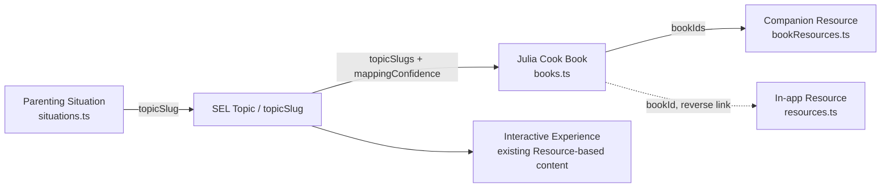

# Book Content Architecture

This document describes how the Julia Cook book catalog
(`src/data/books/`) plugs into this app's existing content model, and why
it was built as a **parallel, independent data module** rather than being
forced through the existing `Resource` / `ContentProvider` machinery
described in [content-model.md](./content-model.md) and
[licensing-architecture.md](./licensing-architecture.md).

## The relationship chain

- A **Parenting Situation** (`src/data/situations.ts`) is the entry point a
  parent lands on — e.g. "my child won't stop interrupting." Each situation
  already carries a `topicSlug` (16 total: `getting-angry`, `interrupting`,
  `sharing`, `fear-of-failure`, `friend-conflict`, `bullying`,
  `not-listening`, `worry-anxiety`, `self-control`, `kindness`,
  `transitions`, `excluded-by-peers`, `school-reluctance`,
  `procrastination`, `low-confidence`, `teen-communication`) and a set of
  `selCompetencies` (the five CASEL-style competencies in
  `src/data/selCompetencies.ts`).
- The **SEL Topic** is that shared `topicSlug` string — it's the join key
  between situations, the existing `topicMappings.ts` keyword/educational-tag
  table, this app's own `Resource` catalog, and now the book catalog. No new
  topic vocabulary was introduced; books link into the *same* 16 slugs the
  rest of the app already uses.
- **Books** (`src/data/books/books.ts`) carry `topicSlugs: string[]` (almost
  always zero or one slug) plus `mappingConfidence` (`"confirmed"` when the
  book's own official tags match this app's topic language, `"hypothesis"`
  when this app's editorial team made the call — see
  [julia-cook-book-catalog.md](./julia-cook-book-catalog.md)) and
  `selCompetencies` for direct SEL-competency linkage independent of the
  situation.
- **Companion Resources** (`src/data/books/bookResources.ts`) hang off a
  book via `bookIds: string[]` — activity books, a Spanish edition, and
  brand-level links (PDF order form, titles/topics PDF, YouTube channel,
  newsletter) that aren't tied to one title.
- The **Interactive Experience** layer is this app's pre-existing
  `Resource` catalog (`src/data/resources.ts`, surfaced via
  `getContentProvider()`). Books connect to it in one place: `Resource`
  gained an optional `bookId?: string` field (`src/types.ts`), and the
  existing `my-mouth-is-a-volcano` resource entry now sets
  `bookId: "my-mouth-is-a-volcano"`, linking this app's own interactive
  companion content back to its real bibliographic source. This is a
  reverse pointer *into* the book catalog from the resource side — new
  interactive resources for other books can adopt the same pattern going
  forward, but it was not retrofitted onto every resource in this pass.

## Why books are a parallel module, not a `ContentProvider` extension

`src/content/ContentProvider.ts` is an abstraction built specifically
around `Resource` — this app's own in-house demo/interactive content,
designed so a future licensed backend (`RemoteContentProvider`) could be
swapped in later without page code changes (see
[licensing-architecture.md](./licensing-architecture.md)).

The book catalog is a fundamentally different kind of data:
- It's **bibliographic metadata about real, externally-published books**,
  not interactive content this app produces or will ever serve/replace with
  a backend.
- It needs its **own verification-level and mapping-confidence vocabulary**
  (`verified_detailed` / `verified_catalog_only`, `confirmed` /
  `hypothesis`) that doesn't map onto `LicensingMetadata`'s existing
  `licenseStatus` values, which describe rights to *interactive* content,
  not "how thoroughly did we check this library catalog entry."
- Every book record still carries a `licensing: LicensingMetadata` field
  (reusing the existing `VERIFIED_BIBLIOGRAPHIC` constant from
  `src/content/licensing.ts`) so it participates in the same discovery-hiding
  safety net (`isHiddenFromDiscovery`) as `Resource` does, if that's ever
  needed — but books are never routed through `getContentProvider()`
  itself, because there is no scenario where a book's bibliographic data
  becomes "remote, licensed content" the way interactive resources might.

Given that, `src/data/books/` implements its own minimal, directly-analogous
API surface instead of extending the `ContentProvider` interface:

| `ContentProvider` (resources) | Books equivalent |
| --- | --- |
| `getResourceById(id)` | `getBookById(id)` |
| `resourcesForTopic(topicSlug)` | `booksForTopic(topicSlug)` |
| `searchResources({ query, topic, filters })` | `searchBooks({ query, topic })` (no `filters` — books don't have `type`/`setting`/`skill` facets) |
| `listResources()` | `books` (exported array; no license-based filtering needed since none are restricted) |

`src/pages/Discover.tsx` (renamed from `Library.tsx` in Phase 4),
`src/pages/SituationPage.tsx`, and `src/pages/BookDetail.tsx` import
`src/data/books/` directly rather than going through `getContentProvider()`,
mirroring how simply they're meant to be used.

## Data flow in each UI surface

- **`SituationPage.tsx`** (a single parenting situation): calls
  `booksForTopic(situation.topicSlug)` and renders matches via
  `BookCard.tsx` in a new "Related books" section, alongside the existing
  `Resource`-based sections.
- **`Discover.tsx`** (global search/browse, formerly `Library.tsx`): calls
  `searchBooks({ query, topic })` alongside the existing `searchResources()`
  call, rendering a separate "Books" results section. Existing
  `type`/`setting`/`skill` filters only apply to the `Resource` results,
  since those facets don't exist on `JuliaCookBook`.
- **`BookDetail.tsx`** (`/books/:bookId`, new route in `App.tsx`): calls
  `getBookById(bookId)`, then `bookResourcesForBook(bookId)` for companion
  resources, and renders the full bibliographic record, the
  situations/topics it's linked to (via a reverse lookup over
  `situations.ts` by `topicSlug`), and an honest notice for
  `verified_catalog_only` books (see
  [book-hub-design.md](./book-hub-design.md) for the UI/UX details of that
  page).

## What was deliberately *not* changed

- `topicMappings.ts`'s structure and keyword-matching logic were reused
  as-is for `matchTopicFromQuery` inside `searchBooks()` (mirroring
  `searchResources()`) — no new topic-matching logic was introduced.
- `situations.ts` itself was not modified by this work; all 16 existing
  `topicSlug`s were treated as a fixed, authoritative vocabulary that books
  map *into*, not the other way around.
- No attempt was made to retrofit `bookId` onto every `Resource` — only the
  one pre-existing, already-book-linked resource
  (`my-mouth-is-a-volcano`) was connected, since it was the only resource
  with an obvious, already-correct real-book counterpart.
