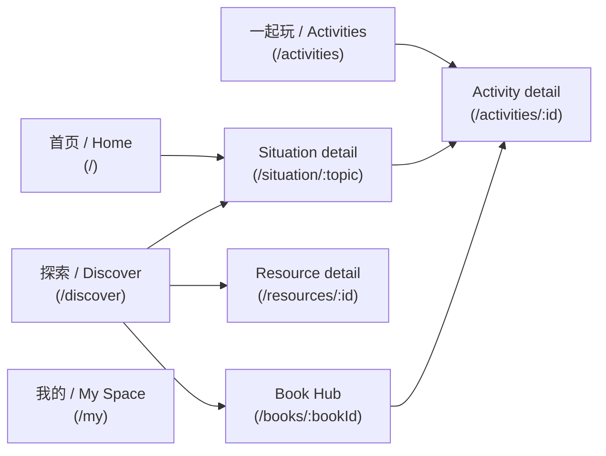

# Frontend Information Architecture (Phase 4)

This replaces the pre-Phase-4 四-section nav (首页 / 理解孩子 / 一起试试看 /
资源库) with a content-first structure: a single discovery hub replaces the
old split Learn/Library pages, Practice is reframed as a browsable activity
library instead of an age-ordered list, and a new personal space consolidates
everything that used to be scattered across Saved/Profile.

## Navigation (`src/components/BottomNavigation.tsx`)

Four persistent bottom-nav tabs:

- **首页 / Home** (`/`) — entry point; a short list of common situations plus
  a featured story and a featured activity.
- **探索 / Discover** (`/discover`) — the unified content-discovery hub (see
  below); replaces the old `/learn` and `/library` pages.
- **一起玩 / Activities** (`/activities`) — the practice-activity library,
  with filter chips and entry cards into the Language Lab and printables;
  replaces the old `/practice` page.
- **我的 / My Space** (`/my`) — saved items, recently viewed, reflections,
  and settings; replaces the old `/profile` and `/saved` pages.

## Routes (`src/App.tsx`)

| Path | Page | Notes |
| --- | --- | --- |
| `/` | `Home` | Entry point |
| `/discover` | `Discover` | Content-discovery hub; see modes below |
| `/activities` | `Activities` | Activity library with filter chips |
| `/activities/:id` | `ActivityDetail` | One activity's goal/materials/steps/reflection questions, via `ActivityGuideViewer` |
| `/situation/:topic` | `SituationPage` | Core situation experience (unchanged from Phase 3) |
| `/language-lab` | `LanguageLab` | "Try saying" interactive practice (unchanged) |
| `/resources/:id` | `ResourceDetailPage` | One resource; renders a viewer scaffold for `video`/`printable` types, an icon hero for `activity`/`book` types; enforces licensing display rules |
| `/books/:bookId` | `BookDetail` | Book Hub — bibliographic detail + grouped companion resources |
| `/my` | `MySpace` | Saved / Recent / Reflections / Settings tabs |

### Backward-compatible redirects

Every pre-Phase-4 deep link keeps working:

| Old path | Redirects to |
| --- | --- |
| `/learn` | `/discover?mode=topics` |
| `/practice` | `/activities` |
| `/practice/:id` | `/activities/:id` |
| `/library` (preserves `?q=`) | `/discover` |
| `/explore`, `/explore/results` | `/discover` |
| `/moment/:topic`, `/moment/:topic/resources` | `/situation/:topic` |
| `/saved` | `/my?tab=saved` |
| `/profile`, `/more` | `/my` |
| any unknown path | `/` |

All redirects are exercised by [`src/App.test.tsx`](/Users/vega/Documents/GitHub/juliacook/src/App.test.tsx).

## Discover (`src/pages/Discover.tsx`)

A single page with two states, controlled by URL search params:

- **Browse** (no active `q`/`topic`/filters) — three switchable modes, kept
  in the `mode` search param (`?mode=stories`, `?mode=resources`; the default
  `topics` mode omits the param so `/discover` stays canonical):
  - **按主题 / Topics** (default) — browse by challenge (topic chips) and by
    age group, same data as the old `/learn` page's topic groupings.
  - **故事 / Stories** — browse by challenge, and by book series (an
    expandable `
` per series, collapsed by default, plus an "no
    series" group) — the book-centric replacement for the old flat library
    shelf.
  - **资源 / Resources** — browsable by format
    (`src/data/resourceFormats.ts`'s `RESOURCE_FORMAT_ORDER`: audiobook,
    video, worksheet, poster, quiz, activity, parent guidance), each section
    showing its matching resources/activities/book-resources or an honest
    "coming soon" message when empty.
- **Results** (`q`, `topic`, or any `FilterContext` filter active) — a flat,
  filtered list from `getContentProvider().searchResources(...)` plus a
  matching set of books from `searchBooks(...)`, with removable filter chips
  above the list.

Covered by [`src/pages/Discover.test.tsx`](/Users/vega/Documents/GitHub/juliacook/src/pages/Discover.test.tsx).

## Book Hub (`/books/:bookId`, `src/pages/BookDetail.tsx`)

Full bibliographic detail for one `JuliaCookBook` (title, series, age range,
topic, synopsis, companion-resource badge) followed by its companion
resources grouped into five possible sections — listen / watch / practice /
print / parent guidance — in that fixed order, with any section that has no
resources simply omitted (not rendered as an empty placeholder). Covered by
[`src/pages/BookDetail.test.tsx`](/Users/vega/Documents/GitHub/juliacook/src/pages/BookDetail.test.tsx).

## Activities (`/activities`, `src/pages/Activities.tsx`)

A browsable library of the 5 original practice activities
(`src/data/activities.ts`), not an age-ordered list: filter chips for "all",
"no materials needed" (`activityNeedsNoMaterials()`), and "quick, under 10
minutes" (`isQuickActivity()`), plus two entry cards into the Language Lab
and a printables shortcut (into Discover's Resources mode, worksheet
format). Covered by
[`src/pages/Activities.test.tsx`](/Users/vega/Documents/GitHub/juliacook/src/pages/Activities.test.tsx).

## My Space (`/my`, `src/pages/MySpace.tsx`)

Four tabs, switched via a `?tab=` search param (`saved` is the default):

- **收藏 / Saved** — reconstructs every saved item from
  `useSavedResources()`'s id list, which stores kind-prefixed ids
  (`situation:<slug>`, `book:<id>`, `activity:<id>`, or a bare resource id)
  so one flat localStorage array can represent four different content
  kinds, grouped into four subsections.
- **最近浏览 / Recent** — `useRecentlyViewed()`'s most-recent-first list
  (situation/book/resource/activity), with a clear-history action. Detail
  pages call `recordView(kind, id)` once on mount.
- **我的记录 / Reflections** — `useReflections()`'s locally saved notes,
  each linked back to its situation.
- **设置 / Settings** — locale switch and age-group switch (same
  underlying `LocaleContext`/`AgeGroupContext` as before, just relocated
  here from the old `/profile` page).

Covered by [`src/pages/MySpace.test.tsx`](/Users/vega/Documents/GitHub/juliacook/src/pages/MySpace.test.tsx).

## Non-navigational layout note

The app renders as a fixed, centered mobile-width "phone frame" container
(`src/index.css`) even at desktop/tablet viewport widths — a deliberate,
pre-existing design choice (not a Phase 4 regression), reconfirmed during
manual QA at 375px and 768px viewports.
