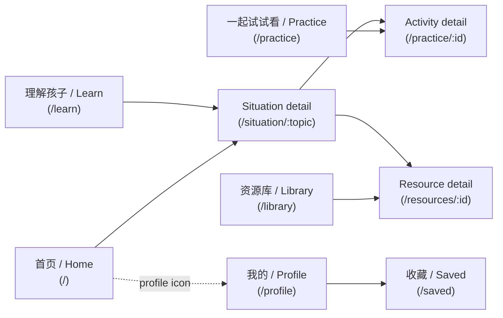

# Information Architecture

## Navigation

Four top-level sections, each with its own bottom-nav tab (`src/components/BottomNavigation.tsx`):

## Routes (`src/App.tsx`)

| Path | Page | Notes |
| --- | --- | --- |
| `/` | `Home` | Entry point; short list of example situations |
| `/learn` | `Learn` | The 5 SEL competencies, each linked to its situations |
| `/practice` | `Practice` | Activity list, ordered by the active age group |
| `/practice/:id` | `ActivityDetail` | One activity's goal/materials/steps/reflection questions |
| `/situation/:topic` | `SituationPage` | Core situation experience (see below) |
| `/library` | `Library` | Browse (no query) or search-results (query/topic/filters active) |
| `/resources/:id` | `ResourceDetailPage` | One resource; enforces licensing display rules |
| `/saved` | `SavedPage` | Locally bookmarked situations + resources |
| `/profile` | `Profile` | Language switch, age-group switch, saved link, about/contact/privacy |

Backward-compatible redirects exist for the pre-restructure route names
(`/moment/:topic` → `/situation/:topic`, `/explore*` → `/library`, `/more` →
`/profile`) so any previously-shared deep link keeps working.

## The situation page (`src/pages/SituationPage.tsx`)

This is the page a parent spends the most time on. Section order:

1. **当前情况 (heading + illustration)** — restates the situation in one line.
2. **理解孩子 (Understand)** — one paragraph on what's developmentally going
   on for the child.
3. **现在可以怎么做？(Respond)** — 2–3 concrete, numbered actions.
4. **换一种说法 (Try saying)** — a "less helpful" phrase crossed out next to
   a "more helpful" one, with a read-aloud button (`src/utils/speak.ts`,
   Web Speech API, locale-aware voice).
5. **了解背后的 SEL 能力 (Learn)** — chips linking to the relevant SEL
   competencies on `/learn`.
6. **一起练习 (Practice)** — a single button into the linked
   `/practice/:id` activity, if the situation has one.
7. **相关资源 (Related resources)** — resources tagged with this topic,
   fetched through `getContentProvider()` so licensing filtering always
   applies (see [content-model.md](./content-model.md)).
8. **记录一点发现 (Reflect)** — a private, local-only note field
   (`src/hooks/useReflections.ts`); no child-identifying information is
   collected or requested.

Content here is **age-aware**: the five flagship journeys
(`getting-angry`, `interrupting`, `sharing`, `fear-of-failure`,
`friend-conflict`) have distinct "younger" (ages 3–10) and "older" (ages
10–13+) copy for every section above; everything else falls back to a
single default write-up. See [content-model.md](./content-model.md) for how
that's modeled.

## Library: browse vs. search

`/library` is a single page with two modes, controlled entirely by URL
search params (`q`, `topic`, plus the `FilterContext` for type/setting/skill
filters):

- **Browse** (no active query/topic/filters): four grouped shelves — by
  challenge, by SEL competency, by age group, by resource type.
- **Results**: a flat, filtered list from
  `getContentProvider().searchResources(...)`.

This merges what used to be two separate pages (`Explore.tsx` and
`SearchResults.tsx`) into one, since the only real difference between them
was "is a query active," not a different layout or data source.
