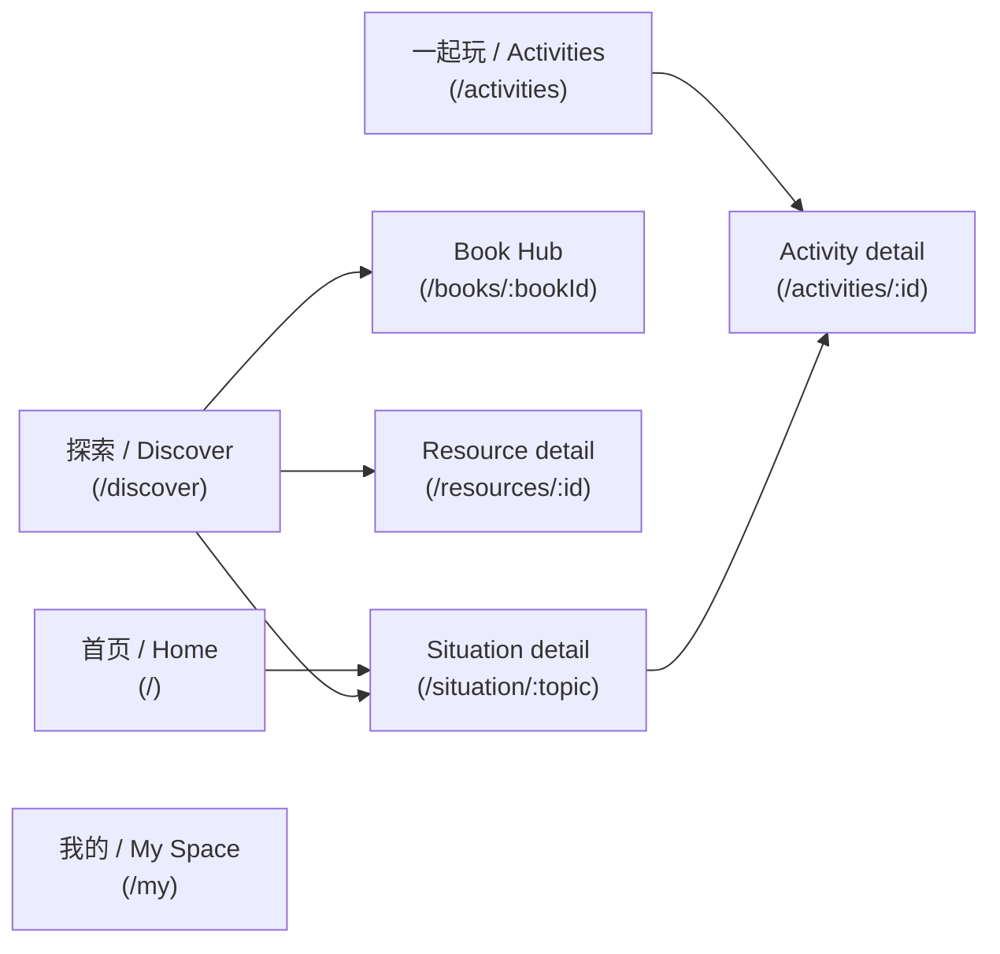

# Information Architecture

> This is the canonical, up-to-date IA doc (rewritten for the Phase 4
> frontend redesign — see
> [frontend-information-architecture.md](./frontend-information-architecture.md)
> for the full route table, mode-by-mode Discover/Activities/My Space
> breakdown, and backward-compatible redirect list).

## Navigation

Four top-level sections, each with its own bottom-nav tab
(`src/components/BottomNavigation.tsx`):

- **首页 / Home** (`/`) — a short list of common everyday situations, plus a
  featured story and a featured activity.
- **探索 / Discover** (`/discover`) — the unified content-discovery hub:
  browse by topic/age, browse stories by book series, or browse resources
  by format, or search/filter across everything. Replaces the old
  `Learn`/`Library` split.
- **一起玩 / Activities** (`/activities`) — the practice-activity library,
  filterable by "no materials needed"/"quick", plus entry cards into the
  Language Lab and printables. Replaces the old age-ordered `Practice`
  page.
- **我的 / My Space** (`/my`) — saved items, recently viewed, reflections,
  and settings (language/age-group), in four tabs. Replaces the old
  `Profile`/`Saved` pages.

## Routes (`src/App.tsx`)

| Path | Page | Notes |
| --- | --- | --- |
| `/` | `Home` | Entry point |
| `/discover` | `Discover` | Topics / Stories / Resources modes, or search results when a query/topic/filter is active |
| `/activities` | `Activities` | Activity list with filter chips |
| `/activities/:id` | `ActivityDetail` | One activity's goal/materials/steps/reflection questions |
| `/situation/:topic` | `SituationPage` | Core situation experience (see below) |
| `/language-lab` | `LanguageLab` | Interactive "try saying" practice |
| `/resources/:id` | `ResourceDetailPage` | One resource; enforces licensing display rules |
| `/books/:bookId` | `BookDetail` | Book Hub: bibliographic detail + grouped companion resources |
| `/my` | `MySpace` | Saved / Recent / Reflections / Settings tabs |

Backward-compatible redirects exist for every pre-Phase-4 route name
(`/learn` → `/discover?mode=topics`, `/practice*` → `/activities*`,
`/library` → `/discover` (preserving `?q=`), `/explore*` → `/discover`,
`/moment/:topic*` → `/situation/:topic`, `/saved` → `/my?tab=saved`,
`/profile`/`/more` → `/my`) so any previously-shared deep link keeps
working — see the full table in
[frontend-information-architecture.md](./frontend-information-architecture.md#backward-compatible-redirects)
and the tests in `src/App.test.tsx`.

## The situation page (`src/pages/SituationPage.tsx`)

This is the page a parent spends the most time on. Section order:

1. **当前情况 (heading + illustration)** — restates the situation in one line.
2. **理解孩子 (Understand)** — one paragraph on what's developmentally going
   on for the child.
3. **现在可以怎么做？(Respond)** — 2–3 concrete, numbered actions.
4. **换一种说法 (Try saying)** — a "less helpful" phrase crossed out next to
   a "more helpful" one, with a read-aloud button (`src/utils/speak.ts`,
   Web Speech API, locale-aware voice).
5. **了解背后的 SEL 能力 (Learn)** — chips linking to the relevant SEL
   competencies.
6. **一起练习 (Practice)** — a single button into the linked
   `/activities/:id` activity, if the situation has one.
7. **相关资源 (Related resources)** — resources tagged with this topic,
   fetched through `getContentProvider()` so licensing filtering always
   applies (see [content-model.md](./content-model.md)) — plus related
   books via `booksForTopic()` (see
   [book-content-architecture.md](./book-content-architecture.md)).
8. **记录一点发现 (Reflect)** — a private, local-only note field
   (`src/hooks/useReflections.ts`); no child-identifying information is
   collected or requested.

Content here is **age-aware**: the five flagship journeys
(`getting-angry`, `interrupting`, `sharing`, `fear-of-failure`,
`friend-conflict`) have distinct "younger" (ages 3–10) and "older" (ages
10–13+) copy for every section above; everything else falls back to a
single default write-up. See [content-model.md](./content-model.md) for how
that's modeled.

## Discover: browse vs. search

`/discover` is a single page with two states, controlled entirely by URL
search params (`q`, `topic`, `mode`, plus the `FilterContext` for
type/setting/skill filters):

- **Browse** (no active query/topic/filters) — three switchable modes
  (Topics, Stories, Resources); see
  [frontend-information-architecture.md](./frontend-information-architecture.md#discover-srcpagesdiscovertsx)
  for the full breakdown.
- **Search results**: a flat, filtered list from
  `getContentProvider().searchResources(...)` plus matching books from
  `searchBooks(...)`.

This merged what used to be two separate pages (`Learn.tsx`/`Library.tsx`)
into one, since browsing and searching share the same underlying data and
differ only in "is a query/filter active," not in layout or data source.
